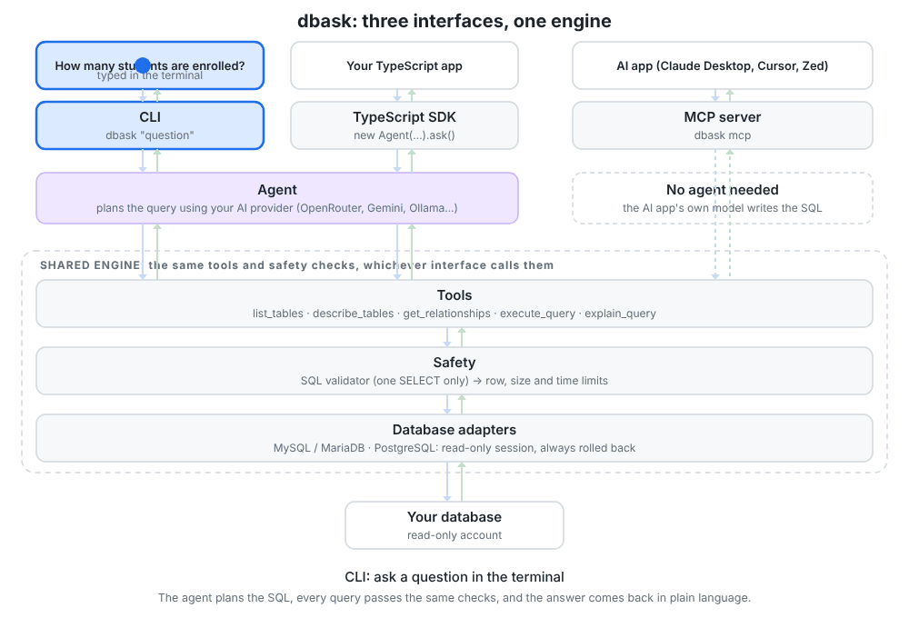

# dbask

**Open-source, privacy-first, self-hostable Text-to-SQL for your existing relational database.**

Ask questions in plain language about a MySQL, MariaDB, or PostgreSQL database you already have. dbask discovers the schema, gives an AI agent tools to inspect and query it, enforces execution limits, and returns an answer. No new schema, no model trained for your app, no hosted service.

Bring your own model. Run it yourself.

> dbask was previously published as `sql-ai-harness`. Install it as `@negusdev/dbask`; the command is `dbask`. If you have the old package installed globally, remove it first (`npm uninstall -g sql-ai-harness`) so the two don't conflict. The SDK API is unchanged apart from the package name.

[](https://www.npmjs.com/package/@negusdev/dbask)
[](https://nodejs.org)
[](./LICENSE)

> **Development status:** dbask is under active development (pre-1.0, so the API may change between minor versions). Validate it against your own schema and workload before relying on it, especially for consequential decisions.

## Documentation

Full documentation: **[https://negusdev.github.io/dbask/](https://negusdev.github.io/dbask/)**

[Quickstart](https://negusdev.github.io/dbask/guide/quickstart) · [Configuration](https://negusdev.github.io/dbask/guide/configuration) · [MCP server](https://negusdev.github.io/dbask/guide/mcp) · [TypeScript SDK](https://negusdev.github.io/dbask/guide/sdk) · [Safety model](https://negusdev.github.io/dbask/guide/safety) · [Troubleshooting](https://negusdev.github.io/dbask/guide/troubleshooting)

## Why dbask

Most Text-to-SQL tools are either a hosted service that sees your schema and data, or tightly coupled to one model and one vendor. dbask is a harness you run yourself, against a database you already own, with a model you choose.

It is a reusable layer between an AI provider and an existing relational database. It is not a new application with its own schema.

## How it fits together



The CLI and the SDK run dbask's agent, which uses your AI provider to plan the query. The MCP server skips the agent: your AI app's own model writes the SQL and dbask only offers the tools. In every case a query passes the same SQL validator, limits and read-only session before it reaches your database.

## Features

- **Natural-language questions** through the CLI or the TypeScript SDK.
- **MCP server** (`dbask mcp`): read-only database tools for Claude Desktop, Cursor, Zed, or any MCP client, with no AI key needed.
- **Bring your own model:** OpenRouter, Google Gemini, DeepSeek, Groq, Cerebras, or Ollama.
- **Schema-aware agent** with tools for listing tables, describing tables, discovering foreign keys, running queries, and `EXPLAIN`.
- **Safety by default:** SQL validation, row, size and time limits, a read-only session enforced by the database, and foreign-key discovery before any SQL runs.
- **Optional `dbask.md`** for business rules and vocabulary the model cannot infer from the schema.
- **No telemetry** and no hosted dependency.
- **Benchmark suite** in `evals/` for reproducible evaluation of changes.

## Requirements

- **Node.js 22 or later**
- A **MySQL, MariaDB, or PostgreSQL** database, and an account with read access to the tables the agent should see
- Credentials and a model ID for one supported AI provider (or a reachable Ollama endpoint); not needed for `dbask mcp`

## Quickstart

```bash
npx @negusdev/dbask init        # writes .env (tests the database connection)
npx @negusdev/dbask validate    # checks config, database and AI provider
npx @negusdev/dbask "How many students are enrolled?"
```

Or install it globally: `npm install --global @negusdev/dbask`, then `dbask "List active users"`.

Use a **dedicated read-only database account**. See the [safety model](https://negusdev.github.io/dbask/guide/safety) for what dbask does and does not protect against.

## Use it from an AI app

Add this to Claude Desktop, Cursor, or another MCP client (Zed and Windows + WSL setups are in the [MCP guide](https://negusdev.github.io/dbask/guide/mcp)):

```json
{
  "mcpServers": {
    "dbask": {
      "command": "npx",
      "args": ["-y", "@negusdev/dbask", "mcp"],
      "env": {
        "DB_DRIVER": "mysql",
        "DB_HOST": "127.0.0.1",
        "DB_NAME": "your_database",
        "DB_USER": "readonly_user",
        "DB_PASSWORD": "your_password"
      }
    }
  }
}
```

## Use it from TypeScript

```ts
import { Agent, createAiProvider, createDatabaseAdapter, loadConfig } from "@negusdev/dbask";

const config = loadConfig();
const database = createDatabaseAdapter(config.database);
const agent = new Agent(
  createAiProvider(config.ai),
  { database, safety: config.safety },
  { maxSteps: config.agent.maxSteps, responseMode: "natural" },
);

try {
  console.log((await agent.ask("List active users")).text);
} finally {
  await database.close();
}
```

See the [SDK guide](https://negusdev.github.io/dbask/guide/sdk) for stability tiers and custom adapters.

## Data handling

dbask itself does not phone home: no telemetry, no crash reporting, no license check, no cloud dependency. What leaves your machine is what your chosen AI provider receives: schema metadata, question text, generated SQL and query results. Review that provider's retention and training terms before using sensitive data. Details in the [safety model](https://negusdev.github.io/dbask/guide/safety#data-handling).

## Evaluation

On the 40-case internal benchmark (synthetic forex database, MySQL, `gemini-3.5-flash-lite`, 3 runs, v0.1.8) the agent passed 39 of 40 cases in every run (97.5%), including 10 of 10 safety and off-topic refusal checks. The one consistent failure is a known reference-answer error in the benchmark. The cases are mostly simple lookups and joins, so treat this as a regression check, not a measure of accuracy on your own database. There is no PostgreSQL figure yet. See [Evals and benchmarks](https://negusdev.github.io/dbask/guide/evals).

## Contributing

Issues and pull requests are welcome. Start with [CONTRIBUTING.md](./CONTRIBUTING.md). For a bug about a wrong answer, include the question, the `--mode debug` output, the relevant table definitions and `dbask.md`, and the provider and model. Do **not** include `.env` contents, credentials, or unfiltered production data.

## License

Released under the [ISC License](./LICENSE).

## Links

- [Documentation](https://negusdev.github.io/dbask/)
- [Source](https://github.com/NegusDev/dbask)
- [npm](https://www.npmjs.com/package/@negusdev/dbask)
- [Issues](https://github.com/NegusDev/dbask/issues)
- [Changelog](./CHANGELOG.md)
- [Business context template](./dbask.example.md)
